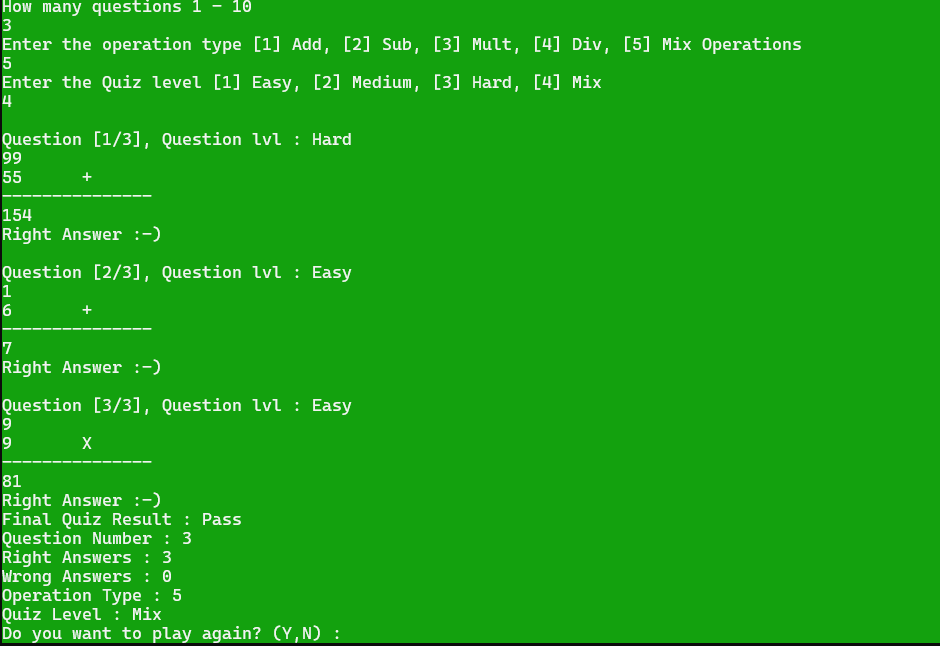
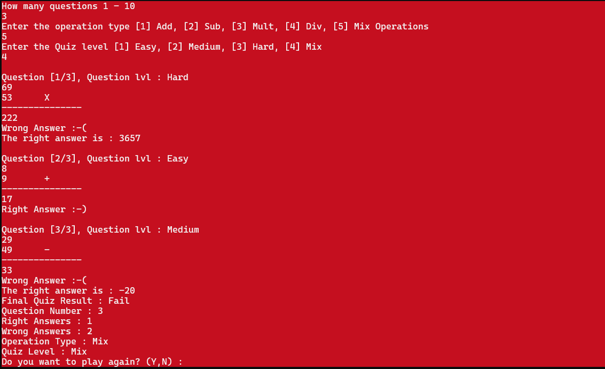

# math_quiz-game
simple math quiz game made with C++ to practice functional/procedural programming, this project is build based on the divide and conquer technique to separate it into many functions and procedures.

- The game asks user how many rounds he wants to play, operation type and the difficulty.

## Photos
- 
- 